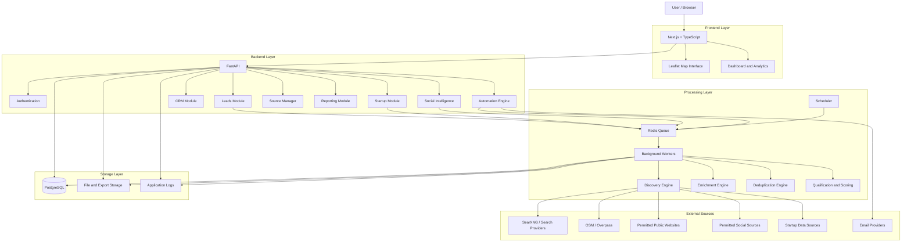
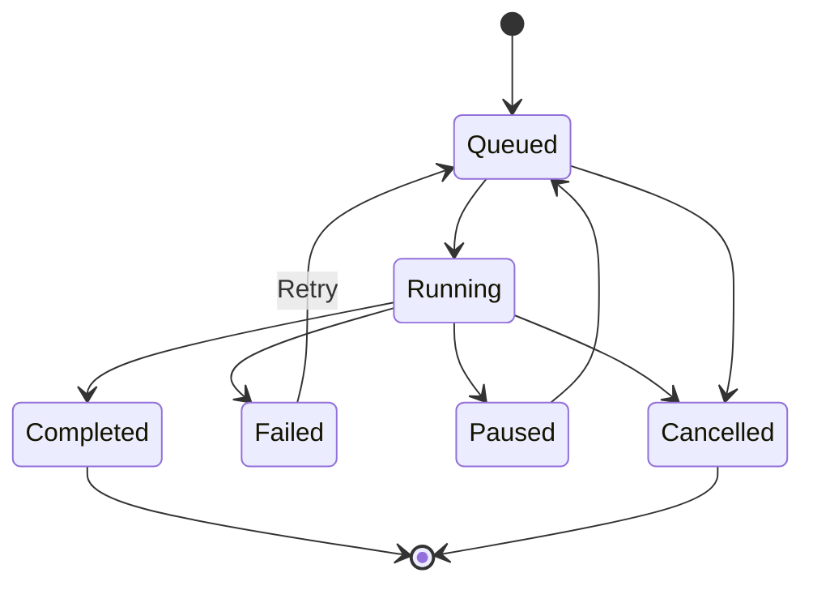
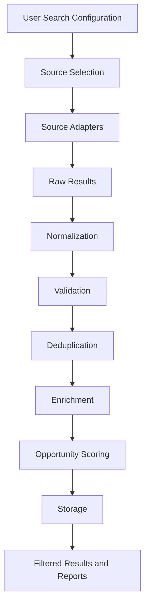
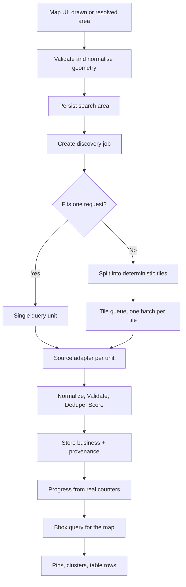

# SparkXFlow — Technical Architecture

**File:** `architecture.md`  
**Version:** 1.0  
**Status:** Initial technical specification  
**Product:** SparkXFlow  
**Architecture style:** Modular Monolith + Background Workers  
**Execution model:** Hybrid Local + Cloud

---

# 1. Architecture Overview

SparkXFlow will use a modular monolithic backend supported by independently executing background workers.

The application will have:

- A Next.js frontend.
- A Python FastAPI backend.
- A PostgreSQL database.
- Redis for job queues and caching.
- Background workers for discovery, enrichment, research, and automation.
- An adapter-based source integration system.
- Optional local AI services.
- Optional cloud deployment.

The initial implementation must remain simple enough for one developer to maintain while allowing future expansion.

## 1.1 Architectural Principles

1. Modular separation of responsibilities.
2. API-first backend design.
3. Background execution for long-running tasks.
4. Free-first technology choices.
5. Local and cloud execution compatibility.
6. Provider-independent source adapters.
7. Strong data provenance.
8. Reliable job execution.
9. Secure secret management.
10. No premature microservices.
11. AI-independent core functionality.
12. Testable business logic.

# 2. High-Level System Architecture



This is a logical architecture, not a requirement to deploy every component as a separate service.

# 3. Technology Stack

## 3.1 Frontend

| Technology | Responsibility |
|---|---|
| Next.js | Application framework |
| React | UI components |
| TypeScript | Type safety |
| Tailwind CSS | Styling |
| shadcn/ui | Reusable interface components |
| Lucide | Icons |
| TanStack Query | Server state and API caching |
| React Hook Form | Form handling |
| Zod | Frontend validation |
| Leaflet | Interactive maps |
| Recharts | Charts and analytics |

Use stable compatible versions and maintain a lockfile.

## 3.2 Backend

| Technology | Responsibility |
|---|---|
| Python | Backend language |
| FastAPI | REST API |
| Pydantic | Validation and schemas |
| SQLAlchemy | Database ORM |
| Alembic | Database migrations |
| httpx | HTTP requests |
| Playwright | Browser automation |
| BeautifulSoup | HTML parsing |
| Redis | Queue and cache infrastructure |
| Celery | Background task execution |

Celery is the preferred initial background job system. Keep task interfaces independent of Celery so another execution backend can be introduced if needed.

## 3.3 Database and Storage

- PostgreSQL: primary relational database.
- Redis: temporary cache, job queue, and coordination.
- Object/file storage: exports, reports, and large artifacts.
- Structured logs: operational diagnostics.

Do not store large raw HTML pages or exports directly inside ordinary relational database fields.

## 3.4 Maps

- Leaflet for rendering.
- OpenStreetMap-compatible data and tile providers.
- Overpass API where permitted for geographic discovery.

Do not assume public OSM tile infrastructure provides unlimited production usage. Use an appropriate provider or self-hosted alternative if usage grows.

**Binding constraints on map work.**

- No Google Maps Platform dependency. Nothing in the design may require a Google API
  key, Google geocoding, or Google's place data. If a paid or keyed provider is
  added later it is one more adapter behind the same contract, never a precondition
  of the map layer.
- Tiles, geocoding and Overpass endpoints are shared public infrastructure. All three
  are used through a single request path per job, with declared per-user and
  per-source rate limits, backoff on `429`/`504`, and attribution where the provider
  asks for it.
- Geocoding (place name → coordinates) is a distinct concern from discovery
  (coordinates → businesses). It is behind its own adapter interface so a self-hosted
  geocoder, Nominatim within its usage policy, or a future paid service can be
  substituted without touching the discovery pipeline. A geocoded result is stored
  with the area it produced, so a saved area does not depend on re-geocoding the same
  string to the same place tomorrow.
- The map library is a client-side concern only. Every map action has an API
  equivalent, so the table view remains fully usable if the map fails to load.
- Geometry the user draws is treated as untrusted input: validated, bounded, and
  normalised server-side before any provider is contacted. The client's tile count is
  advisory; the server recomputes it.

# 4. Backend Architecture

## 4.1 Modular Monolith

All primary business modules live within one backend application but have clear boundaries.

Recommended modules:

```text
backend/
├── app/
│   ├── main.py
│   ├── core/
│   │   ├── config.py
│   │   ├── security.py
│   │   ├── database.py
│   │   ├── logging.py
│   │   └── exceptions.py
│   │
│   ├── modules/
│   │   ├── auth/
│   │   ├── users/
│   │   ├── leads/
│   │   ├── businesses/
│   │   ├── contacts/
│   │   ├── discovery/
│   │   ├── enrichment/
│   │   ├── deduplication/
│   │   ├── qualification/
│   │   ├── crm/
│   │   ├── services/
│   │   ├── startups/
│   │   ├── social_intelligence/
│   │   ├── automation/
│   │   ├── scheduler/
│   │   ├── email/
│   │   ├── sources/
│   │   ├── analytics/
│   │   ├── reports/
│   │   ├── notifications/
│   │   ├── imports_exports/
│   │   └── search/
│   │
│   ├── integrations/
│   │   ├── search/
│   │   ├── maps/
│   │   ├── social/
│   │   ├── startup_sources/
│   │   ├── email/
│   │   └── storage/
│   │
│   ├── workers/
│   ├── shared/
│   └── api/
│
├── migrations/
├── tests/
├── requirements/
└── pyproject.toml
```

Each module should contain its own:

- Models.
- Schemas.
- Services.
- Repository/data-access logic where useful.
- API routes.
- Tests.

Avoid circular dependencies.

Shared infrastructure must not become a dumping ground for business logic.

# 5. Frontend Architecture

Recommended structure:

```text
frontend/
├── app/
│   ├── (auth)/
│   ├── (dashboard)/
│   │   ├── dashboard/
│   │   ├── leads/
│   │   ├── map-explorer/
│   │   ├── startups/
│   │   ├── social/
│   │   ├── automation/
│   │   ├── sources/
│   │   ├── analytics/
│   │   ├── reports/
│   │   └── settings/
│   ├── layout.tsx
│   └── globals.css
│
├── components/
│   ├── ui/
│   ├── layout/
│   ├── dashboard/
│   ├── leads/
│   ├── maps/
│   ├── startups/
│   ├── social/
│   ├── automation/
│   ├── analytics/
│   └── shared/
│
├── hooks/
├── lib/
│   ├── api/
│   ├── auth/
│   ├── validation/
│   └── utils/
│
├── types/
├── stores/
└── public/
```

Requirements:

- Separate presentation from business logic.
- Reuse shared components.
- Use typed API clients.
- Validate important form inputs.
- Keep secrets out of browser bundles.
- Use server state caching appropriately.
- Avoid unnecessary global state.
- Ensure loading, empty, and error states are consistent.

# 6. API Architecture

Use REST APIs initially.

Base path:

```text
/api/v1/
```

Example endpoint groups:

```text
/api/v1/auth
/api/v1/users
/api/v1/businesses
/api/v1/leads
/api/v1/discovery
/api/v1/jobs
/api/v1/services
/api/v1/qualification
/api/v1/crm
/api/v1/startups
/api/v1/social
/api/v1/sources
/api/v1/workflows
/api/v1/schedules
/api/v1/email
/api/v1/approvals
/api/v1/notifications
/api/v1/analytics
/api/v1/reports
/api/v1/search
/api/v1/search-areas
/api/v1/imports
/api/v1/exports
```

API requirements:

- Consistent response structure.
- Request validation.
- Pagination.
- Filtering and sorting.
- Authentication and authorization.
- Clear error responses.
- API versioning.
- OpenAPI documentation.

Long-running operations must return a job identifier rather than keeping the HTTP request open.

Example:

```json
{
  "job_id": "job_123",
  "status": "queued",
  "message": "Discovery job queued"
}
```

**Discovery and area endpoints.**

The job endpoints below are live; `search-areas` and the `bbox` parameter are the
specified contract for the map work and are not built yet — current status is in
`REQUIREMENTS_TRACEABILITY.md`.

```text
POST   /api/v1/discovery/jobs              create and dispatch a job (area or text query)
GET    /api/v1/discovery/jobs              the caller's jobs, newest first
GET    /api/v1/discovery/jobs/{id}         status, observed counters, per-source report
GET    /api/v1/discovery/jobs/{id}/logs    what the job said, in order
POST   /api/v1/discovery/jobs/{id}/cancel  stop between units of work
GET    /api/v1/businesses?bbox=...         owner-scoped records inside a viewport
POST   /api/v1/search-areas                save a drawn or resolved area
GET    /api/v1/search-areas                the caller's saved areas
DELETE /api/v1/search-areas/{id}           remove a saved area
```

Job responses expose only observed numbers — records returned, stored, rejected,
merged, and per-source outcomes including failures. There is no estimated-ETA field,
and a `blocked` job (no worker available) is distinct from a `failed` one.

Map geometry reaches the server as JSON, never as a query string fragment appended to
provider syntax. `GET /api/v1/businesses?bbox=...` is read-only and owner-scoped; area
writes require the same CSRF protection as every other state change.

# 7. Background Job Architecture

## 7.1 Job Queue

Redis and Celery will manage background execution.

Worker categories should initially be logical queues, not necessarily separate deployments:

- Discovery.
- Enrichment.
- Research.
- Qualification.
- Imports and exports.
- Automation.
- Scheduled jobs.

## 7.2 Job Lifecycle



Each job should track:

- Job ID.
- Job type.
- User or owner.
- Configuration.
- Status.
- Progress.
- Total records.
- Processed records.
- Failed records.
- Start time.
- End time.
- Retry count.
- Error details.
- Source information.

## 7.3 Reliability

Implement:

- Retries with backoff.
- Rate limiting.
- Per-source concurrency controls.
- Timeouts.
- Idempotency where practical.
- Resumable batch processing.
- Graceful worker shutdown.
- Dead-letter or permanently failed job handling.
- Job cancellation where supported.

A worker crash must not silently mark unfinished work as successful.

Progress should be based on actual processing, not simulated percentages.

# 8. Hybrid Execution Architecture

SparkXFlow must support two execution environments.

## 8.1 Local Execution

Local mode allows workers to run on the user's PC.

Use cases:

- Heavy browser automation.
- Local AI inference.
- Large research jobs.
- Development and testing.
- Optional local data processing.

The PC must be running for local workers to execute.

## 8.2 Cloud Execution

Cloud mode runs the application and workers on remote infrastructure.

Use cases:

- Scheduled discovery.
- Persistent workflows.
- Remote dashboard access.
- Notifications.
- Cloud-hosted background jobs.

Cloud jobs must continue while the user's PC is switched off.

## 8.3 Hybrid Job Routing

A job should declare its execution requirements.

Example execution targets:

- Cloud preferred.
- Local preferred.
- Either.
- Local-only.

The scheduler should dispatch work to a compatible available worker.

If a local-only worker is unavailable, the job should remain queued or clearly report its blocked status. It must not silently execute somewhere else if that changes privacy or resource expectations.

## 8.4 Worker Registration

Each worker registers:

- Worker ID.
- Execution environment.
- Capabilities.
- Supported job types.
- Health status.
- Last heartbeat.
- Available capacity.

Worker heartbeats should identify unavailable workers and prevent new work from being assigned to them.

## 8.5 Data Consistency

Local and cloud workers must use compatible job contracts and processing rules.

Do not allow independent copies of the database to become conflicting sources of truth.

The initial production database should have one authoritative location. Local workers should connect securely to it or receive explicitly assigned work and return results through authenticated APIs.

Avoid exposing PostgreSQL or Redis publicly.

# 9. Discovery Engine

The Discovery Engine is a shared infrastructure service used by Leads, Startup, and Social Intelligence.

## 9.1 Adapter Architecture

Each source should implement a common adapter contract.

Conceptual interface:

```python
class DiscoveryAdapter:
    async def validate_config(self, config):
        ...

    async def discover(self, config):
        ...

    async def health_check(self):
        ...

    async def get_capabilities(self):
        ...
```

Each adapter should declare:

- Source name.
- Source category.
- Supported query types.
- Supported filters.
- Geographic coverage.
- Available fields.
- Access requirements.
- Rate limits where known.
- Terms and limitations.

Do not assume all sources support the same search filters.

## 9.2 Initial Source Adapters

### Search Intelligence

- Self-hosted SearXNG.
- Configured public search providers.
- RSS and public feeds where appropriate.

SearXNG provides search discovery. It is not a complete web extraction engine.

### Geographic Intelligence

- OpenStreetMap.
- Overpass API.
- Other permitted geographic datasets.

### Website Intelligence

- HTTP clients.
- Playwright for permitted browser-based access.
- BeautifulSoup for HTML extraction.

### Social Intelligence

Use platform-specific permitted access methods and public datasets.

Each platform must have independent capability and restriction handling.

### Startup Intelligence

- Product Hunt where access is permitted.
- Hacker News.
- Reddit.
- GitHub.
- Public startup directories.
- Public company websites and pricing pages.

## 9.3 Discovery Pipeline



Store raw records separately from normalized business or startup entities.

Every record must retain source attribution and retrieval timestamps.

## 9.4 Geographic Discovery and Map Data Flow

Map-based discovery is the discovery pipeline driven by a geometry instead of a text
query. Everything before and after the pipeline stays the same: normalisation,
validation, deduplication, provenance and ownership rules are shared, so a business
found by drawing a polygon and a business found by keyword are indistinguishable in
storage.

### Area representation

One normalised area object is used whether the user typed "Indiranagar, Bengaluru",
picked a centre and radius, or drew a polygon.

```text
area = {
  shape_type:        circle | rectangle | polygon | administrative
  center:            {lat, lng}          (circle)
  radius_m:          integer             (circle)
  bbox:              [west, south, east, north]   (all shapes, derived)
  polygon:           [[lat, lng], ...]   (polygon, closed ring, min 3 vertices)
  admin:             {country, state, city, locality}
  geocode:           {query, resolved_at, provider, external_id} | null
}
```

Server-side rules before anything is sent to a provider:

- Coordinates are validated to `[-90, 90]` / `[-180, 180]`, and the bounding box must
  be ordered (`west <= east`, `south <= north`).
- Vertex count, radius and total area each have hard ceilings. A request beyond a
  ceiling is refused with the reason and a suggested smaller unit; it is never
  silently clipped, because a truncated search reads as an empty market.
- An administrative selection resolves to an area through the geocoding adapter and
  is then treated as any other area. The resolved geometry is stored with the area so
  a saved area is reproducible without re-geocoding.
- Geometry is data, never code. It is passed to the database as bound parameters, and
  it is never interpolated into a query language. The Overpass tag whitelist and the
  existing QL construction rules cover the query side.

### Grid tiling for regions larger than one request

A source request has a maximum area it can honestly cover. Anything bigger is divided
into a regular lat/lng grid of tiles sized so each tile fits inside that limit.

- Each tile becomes one `job_batches` row carrying its bounds and its own counters,
  so per-tile progress, failure and retry are first-class state rather than a log
  line to infer them from.
- Tiles are processed sequentially per source, with bounded concurrency across
  sources only. Overpass throttles by IP and rejects concurrent heavy queries; a
  fan-out of tiles against a shared public instance is a denial of service on
  infrastructure nobody is paying for.
- A tile that fails is recorded with its failure classification and the job continues.
  A job whose tiles all fail is `failed`; a job where some succeeded is `completed`
  with the failures named. Neither outcome is rounded up to look better.
- Cancellation is honoured between tiles. Records already stored stay stored.
- A tile returning exactly the provider's element cap is treated as truncated, not
  complete: the tile is subdivided and re-run, or reported as needing a smaller tile.

**Measured behaviour (D4, 2026-11-02).** Against the public `overpass-api.de`
interpreter, one 78.5 km² circle at a 200-element limit took **36–45 seconds** and
**7 of 12 queries failed** with `502`, `504`, or an error page delivered under
HTTP 200. Four consequences are now design facts rather than preferences:

- Tile size is chosen against *latency and refusal rate*, not coverage. Defaults:
  25 km² per tile, at most 40 tiles per job, one level of subdivision, one request in
  flight, 90 s client timeout. Larger tiles answer slower and fail more often; many
  more tiles is precisely what a saturated endpoint cannot take.
- A **200 response is not proof of an answer**. The adapter parses the body before
  treating the query as successful; a non-JSON body under a success status is a
  retryable `MalformedResponseError`, not an empty result. Reporting a provider's
  outage as "no businesses found" would convert an infrastructure failure into a
  false statement about a market.
- Public Overpass is a development path. Production geographic discovery assumes a
  self-hosted or contracted endpoint, configured through `SPARKX_OVERPASS_BASE_URL`.
- Geographic coverage is uneven by category and must be reported as such. In the
  measured circle, `amenity=hospital` returned 80 located, named records while
  `amenity=restaurant` returned 2 and `shop=grocery` returned 0. A map that shows
  hospitals but no shops is reporting OSM's mapping habits, not the city — which is
  why Overpass supplements search and website discovery and never carries it.



### Adapter contract for geographic sources

Adapters declare what geometry they can accept, so the planner can route work and the
UI can promise only what a source can deliver:

```python
class DiscoveryAdapter:
    # existing contract
    async def discover(self, query): ...
    async def health_check(self): ...
    def get_capabilities(self): ...

    # geographic declarations
    supports_area_queries: bool          # accepts a polygon / bbox directly
    supported_shapes: tuple[str, ...]    # e.g. ("circle", "rectangle", "polygon")
    max_area_km2: float                  # before tiling is required
    max_elements_per_request: int
    requires_category: bool
```

Overpass is the area-capable source: it answers "what is inside this shape". SearXNG
is not — it answers keyword and locality-text queries, so a geographic job using it
degrades to the administrative labels (city, locality) rather than pretending a
polygon was searched. The capabilities the source declares decide which parts of the
user's request were actually honoured, and that is surfaced to the user.

This is also why the platform is not Overpass-only: an unmapped local business is
invisible to OSM by construction, and a map that shows only what volunteers mapped
will systematically under-report exactly the small businesses the product is for.

### Serving the map

- Pins come from an owner-scoped, filter-scoped query bounded by the current
  viewport, not by loading the whole result set into the browser.
- The response carries only what a pin and its preview need: identifier, coordinates,
  name, category, the availability flags the filters use, and the source reference.
- Clustering is the client's job at zoom levels; the server never returns more than
  the configured viewport limit, and when it hits that limit it says so, so a busy
  area is not mistaken for a filtered one.
- Records without usable coordinates are still results. They appear in the table, are
  counted in the totals, and are reported as "unlocated" — they are not silently
  dropped just because the map cannot draw them.
- Coordinates are stored at the precision the source provided. A business is never
  given a centroid it did not have in order to make a pin appear.

### Deduplication across overlapping areas

Overlapping tiles, adjacent searches and repeated runs all produce the same business
more than once. Identity is decided by the shared deduplication rules — domain, phone,
then normalised name with address — and never by coordinates alone. Two businesses in
one building are real; two spellings of one business are real; a pin position is not an
identifier.

A confirmed merge transfers the losing record's provenance to the survivor, so a
business found by three overlapping tiles carries three source rows and one business
row. `job_batches` keeps the per-tile sighting, and the business keeps every
attribution. A re-run of a saved area therefore reports "N known, M new", not M+N
fresh leads.

# 10. Enrichment Architecture

Enrichment should be modular.

Possible enrichment tasks:

- Website metadata.
- Business descriptions.
- Public contact details.
- Social links.
- Business category.
- Geographic information.
- Technology signals.
- Website condition signals.
- Public company information.

Each enrichment operation should record:

- Field or information enriched.
- Previous value where appropriate.
- New value.
- Source.
- Retrieval time.
- Confidence.
- Verification status.

Do not overwrite trustworthy existing information without preserving its history.

# 11. Deduplication Architecture

Use multiple matching methods:

1. Exact phone matching.
2. Exact email matching.
3. Normalized domain matching.
4. Profile URL matching.
5. Name and address similarity.
6. Fuzzy matching.

Classify matches as:

- Confirmed duplicate.
- Probable duplicate.
- Possible duplicate.
- Not a duplicate.

Automatically merge only confirmed duplicates.

Preserve source records, historical values, and provenance during merges.

# 12. Qualification and Scoring Engine

The scoring engine must be configuration-driven.

A service-specific scoring profile should define:

- Signals.
- Weights.
- Required criteria.
- Exclusion criteria.
- Confidence requirements.
- Qualification thresholds.

One business may receive multiple scores for different services.

Each score must provide:

- Numerical score.
- Supporting evidence.
- Applied rules.
- Missing information.
- Confidence.
- Timestamp.
- Scoring profile version.

Scores should be reproducible using stored rule versions.

AI may assist with interpretation, but scoring must have a deterministic fallback.

# 13. Automation Engine Architecture

The Automation Engine should be independent of any individual module.

Components:

- Workflow Manager.
- Trigger Manager.
- Scheduler.
- Job Dispatcher.
- Rules Engine.
- Email Generation.
- Approval Manager.
- Sending Adapter.
- Reply Tracking.
- Suppression and Compliance Manager.

## 13.1 Workflow Execution

Each workflow execution should have:

- Workflow ID.
- Execution ID.
- Trigger details.
- Step history.
- Input and output references.
- Status.
- Errors.
- Start and end timestamps.

## 13.2 Approval Gate

Email sending must require explicit approval initially.

An approval record must preserve:

- Original generated content.
- Edited content.
- Reviewer decision.
- Approval timestamp.
- Sending status.

Approval must be separate from successful delivery.

## 13.3 Email Provider Adapters

Initial integration: Gmail OAuth.

Future providers:

- Outlook.
- Generic SMTP.

Provider-specific implementations must sit behind a common interface.

Never store provider secrets in frontend code or unencrypted database fields.

## 13.4 Responsible Outreach

Implement:

- Sending limits.
- Duplicate recipient prevention.
- Suppression lists.
- Unsubscribe handling.
- Bounce tracking.
- Clear sender identity.
- Applicable compliance controls.

# 14. Startup Intelligence Architecture

Startup Intelligence should reuse shared discovery, enrichment, storage, search, and reporting infrastructure.

It should maintain its own domain models and business logic.

Major internal components:

- Startup Discovery.
- Startup Profiles.
- Founder Research.
- Product Research.
- Pricing Intelligence.
- Revenue Intelligence.
- Competitor Tracking.
- Watchlists.
- Market Research.

Revenue records must store:

- Amount and currency when available.
- Reporting period.
- Classification.
- Source.
- Methodology.
- Assumptions for estimates.
- Confidence.
- Last updated date.

Never manufacture revenue data.

# 15. Social Intelligence Architecture

Social Intelligence must use independent platform adapters.

Each adapter should report:

- Supported access method.
- Publicly accessible fields.
- Search capabilities.
- Limitations.
- Last successful execution.
- Errors.
- Applicable restrictions.

The collection engine should be user-configurable.

If a platform does not provide permitted access for a requested operation, report that limitation clearly.

# 16. AI Architecture

AI should be a replaceable service layer.

Conceptual architecture:

```text
AI Service Interface
        |
        ├── Local Model Provider
        ├── Optional Free Provider
        ├── Optional Paid Provider
        └── Rule-Based Fallback
```

Potential AI tasks:

- Summarization.
- Classification assistance.
- Research synthesis.
- Email personalization.
- Opportunity explanations.

Requirements:

- AI is not required for core discovery.
- All provider calls must be optional.
- Provider selection must be configurable.
- Avoid sending unnecessary sensitive information.
- Validate model output.
- Store evidence separately from generated conclusions.
- Clearly distinguish factual data from AI-generated interpretation.

Local inference may use a compatible local model runtime such as Ollama, subject to hardware capability.

Do not assume the user's PC can run large models efficiently.

# 17. Search Architecture

Start with PostgreSQL full-text search and appropriate indexes.

Search should cover:

- Businesses.
- Contacts.
- Startups.
- Reports.
- Research records.

Implement:

- Normalized search fields.
- Full-text indexes.
- Trigram matching where useful.
- Filters.
- Pagination.
- Relevance ranking.

Introduce a dedicated search engine only if actual usage and performance justify it.

**Geographic filtering.** Reading "what is in this viewport or area" is a filter on
stored coordinates, not a text search. Start with bounding-box comparisons on
`latitude`/`longitude` with a composite index scoped by `owner_user_id`; a bbox is a
correct pre-filter for any polygon because it can only over-include, and the polygon
test is then applied to the small candidate set. PostGIS — with true geometry types,
spatial indexes and `ST_Contains` — is introduced when measured pin density or area
overlap makes the two-step approach insufficient, not before. Deferred spatial
indexing must never become a reason to display fewer records than exist: the count
shown next to a map is the count from the same query that produced the pins.

# 18. File and Export Storage

Use PostgreSQL for structured data and separate storage for larger artifacts.

Examples:

- CSV exports.
- Excel exports.
- PDF reports.
- Research documents.
- Temporary processing files.

Create a storage adapter so local filesystem storage can be replaced with object storage without changing business modules.

Apply access controls and expiration policies to temporary files.

# 19. Authentication and Security Architecture

Initial application access is private and single-user.

Implement:

- Secure authentication.
- Secure session handling.
- Password hashing if password authentication is used.
- CSRF protection where applicable.
- Rate limits.
- Input validation.
- Authorization checks.
- Secure secret storage.
- Audit logging.
- Secure headers.
- Backup protection.

Do not expose secrets through:

- Browser bundles.
- Client-side logs.
- API responses.
- Error messages.
- Git repositories.

Use environment variables or a suitable secret manager.

Plan the data model so future multi-user access can be added without redesigning every table.

# 20. Observability

Implement structured logging and operational monitoring.

Track:

- API request failures.
- Background job failures.
- Worker availability.
- Source health.
- Queue depth.
- Processing duration.
- Rate-limit events.
- External provider errors.
- Storage usage.
- Backup status.

Logs should contain correlation IDs for connecting API requests with background jobs.

Avoid logging secrets, passwords, tokens, or unnecessary personal information.

# 21. Backup and Recovery

Initial backup policy:

- Daily backups.
- Seven daily restore points.
- Longer-term weekly retention.
- Separate backup storage.
- Periodic restore tests.
- CSV export support.

Backups must cover the database and relevant configuration or metadata.

A backup is not considered reliable until restoration has been tested.

# 22. Deployment Architecture

## 22.1 Initial Deployment Direction

| Component | Initial preference |
|---|---|
| Frontend | Vercel |
| Backend API | Railway |
| Background workers | Railway |
| PostgreSQL | Managed PostgreSQL |
| Redis | Managed Redis |
| File storage | Free/self-hosted compatible storage |

Render may be evaluated as an alternative.

All free-tier availability, sleep behavior, quotas, and pricing must be checked before final provider selection.

Do not assume that a free plan guarantees permanent, uninterrupted execution.

## 22.2 Local Development

Provide a reproducible local environment.

Recommended:

- Frontend development server.
- FastAPI development server.
- PostgreSQL.
- Redis.
- Background worker.
- Optional local AI runtime.

Docker Compose may be used to simplify local infrastructure.

## 22.3 Production Environment

Separate:

- Frontend.
- API process.
- Worker process.
- Scheduler process where necessary.
- Database.
- Redis.
- File storage.

These can initially share a hosting provider while remaining logically separate processes.

## 22.4 Environment Configuration

Maintain:

- `.env.example`.
- Environment-specific configuration.
- Validated settings.
- Separate development and production secrets.

Never commit actual credentials.

# 23. Scalability Strategy

Scale only when actual usage requires it.

Initial approach:

- One backend application.
- A small number of worker processes.
- PostgreSQL indexing.
- Redis queues.
- Batch processing.
- Rate limits.
- Pagination.

Future options:

- Additional worker replicas.
- Dedicated source workers.
- Read replicas.
- Search engine.
- Object storage.
- Separate high-load modules.

Do not introduce microservices in the initial release.

# 24. Testing Architecture

Testing must cover:

### Unit tests
- Business logic.
- Qualification rules.
- Data normalization.
- Deduplication.
- Validation.

### Integration tests
- Database operations.
- API endpoints.
- Redis queues.
- Worker execution.
- Source adapters.

### End-to-end tests
- Authentication.
- Discovery workflow.
- Business profile.
- CRM operations.
- Export.
- Workflow approval.

### Reliability tests
- Worker restart.
- Failed source.
- Job retry.
- Duplicate job submission.
- Interrupted processing.

Use test fixtures and mocked external services. Do not make ordinary automated tests dependent on unreliable public providers.

# 25. Development and Engineering Rules

1. Read all product documentation before implementation.
2. Create a consistent project structure before building features.
3. Use modular boundaries.
4. Use migrations for database changes.
5. Never modify production schemas manually.
6. Write tests for important business logic.
7. Use type hints and validation.
8. Never hardcode credentials.
9. Never fake successful operations.
10. Do not silently ignore failures.
11. Preserve source attribution.
12. Implement idempotency for important background operations.
13. Keep UI and API contracts synchronized.
14. Maintain documentation as the architecture evolves.
15. Do not introduce paid dependencies without explicit justification.
16. Do not implement unsupported scraping methods.
17. Use dependency versions that are compatible and maintained.
18. Prefer simple, proven solutions over unnecessary infrastructure.

# 26. Architecture Acceptance Criteria

The architecture is successfully implemented when:

- Frontend communicates with the backend through documented APIs.
- Backend modules have clear boundaries.
- PostgreSQL stores structured application data.
- Redis and background workers execute long-running jobs.
- Jobs can report real progress and errors.
- Discovery adapters can be independently enabled or disabled.
- Multiple discovery sources feed a shared processing pipeline.
- Enrichment and deduplication preserve provenance.
- A drawn or resolved area can drive a discovery job, and regions too large for one
  request are tiled deterministically with per-tile progress, failure and retry.
- Geographic sources declare the geometry they support; a source that cannot answer a
  spatial question is not credited with having answered it.
- Map rendering is viewport-bounded and owner-scoped, and its counts come from the
  same query as its pins.
- The map layer depends on no single keyed provider.
- Service scoring is configurable.
- Local and cloud workers follow compatible execution contracts.
- AI can be disabled without breaking core functionality.
- Email integrations use provider adapters.
- Secrets are protected.
- Backups can be restored.
- Automated tests cover critical flows.
- The system can expand without requiring an initial microservices redesign.

---

**End of architecture.md v1.0**