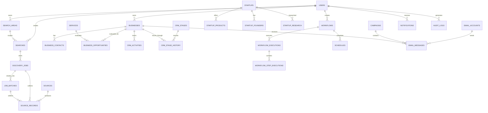

# SparkXFlow — Database Schema Specification

**File:** `database-schema.md`  
**Version:** 1.0  
**Database:** PostgreSQL  
**ORM:** SQLAlchemy  
**Migrations:** Alembic  
**Status:** Initial specification

---

# 1. Database Design Principles

SparkXFlow will use PostgreSQL as its primary relational database.

The schema must support:

- Leads Intelligence.
- Startup Intelligence.
- Social Intelligence.
- Automation Engine.
- CRM.
- Source management.
- Research history.
- Analytics.
- Imports and exports.
- Notifications.
- User preferences.
- Data retention.

### Core principles

1. Use relational tables for structured business data.
2. Use UUID primary keys for major entities.
3. Maintain foreign-key relationships.
4. Use timestamps consistently in UTC.
5. Store original source information and provenance.
6. Avoid unnecessary duplication.
7. Preserve historical changes where useful.
8. Use JSONB only for genuinely flexible data.
9. Add indexes based on actual query patterns.
10. Use database migrations for every schema change.
11. Never silently delete valuable records during deduplication.
12. Design for future multi-user support without overengineering the initial release.

# 2. Database Architecture

The database will be logically organized into domains.

| Domain | Responsibility |
|---|---|
| Core | Users, settings, authentication |
| Sources | Source providers, configurations, health |
| Discovery | Searches, jobs, raw results |
| Leads | Businesses, contacts, opportunities |
| CRM | Pipeline, stages, activities |
| Startups | Startups, products, founders, competitors |
| Social | Platforms, profiles, collected content |
| Automation | Workflows, executions, approvals |
| Email | Accounts, campaigns, messages |
| Analytics | Metrics and reports |
| System | Notifications, audit logs, retention |

Use PostgreSQL schemas or clear table naming conventions. The initial implementation should prefer a straightforward public schema with consistent prefixes unless there is a demonstrated reason to split database schemas.

# 3. Entity Relationship Overview



This is a logical relationship overview. Additional association tables and history tables are required for the complete implementation.

# 4. Common Database Conventions

## 4.1 Primary Keys

Use UUIDs for major entities.

Example:

```sql
id UUID PRIMARY KEY DEFAULT gen_random_uuid()
```

Ensure the required PostgreSQL UUID generation support is available.

## 4.2 Standard Timestamps

Most major tables should include:

```sql
created_at TIMESTAMPTZ NOT NULL DEFAULT NOW(),
updated_at TIMESTAMPTZ NOT NULL DEFAULT NOW()
```

Use `deleted_at` for entities requiring soft deletion.

Use UTC for storage and convert to the user's timezone in the frontend.

## 4.3 Ownership

User-owned tables should include:

```sql
owner_user_id UUID REFERENCES users(id)
```

This supports the initial private single-user model and future multi-user expansion.

## 4.4 Flexible Metadata

Use JSONB for variable source-specific metadata, provider configuration, and flexible workflow settings.

Do not put all relational business information inside JSONB.

---

# 5. Core Tables

## 5.1 users

Stores application users.

| Field | Type | Description |
|---|---|---|
| id | UUID | Primary key |
| email | VARCHAR(320) | Unique login email |
| password_hash | TEXT | Password hash, if password authentication is used |
| display_name | VARCHAR(150) | User display name |
| is_active | BOOLEAN | Account status |
| is_superuser | BOOLEAN | Administrative permission |
| created_at | TIMESTAMPTZ | Creation time |
| updated_at | TIMESTAMPTZ | Last update |

Do not store plaintext passwords.

## 5.2 user_settings

Stores application preferences.

| Field | Type |
|---|---|
| id | UUID |
| user_id | UUID |
| settings | JSONB |
| timezone | VARCHAR(100) |
| theme | VARCHAR(20) |
| created_at | TIMESTAMPTZ |
| updated_at | TIMESTAMPTZ |

One settings record per user.

## 5.3 user_sessions

Stores session metadata if server-managed sessions are used.

| Field | Type |
|---|---|
| id | UUID |
| user_id | UUID |
| session_token_hash | TEXT |
| expires_at | TIMESTAMPTZ |
| revoked_at | TIMESTAMPTZ |
| created_at | TIMESTAMPTZ |

Store only appropriately protected session identifiers.

---

# 6. Source Management Tables

## 6.1 sources

Registry of all configured discovery providers.

| Field | Type | Description |
|---|---|---|
| id | UUID | Primary key |
| name | VARCHAR(150) | Source name |
| slug | VARCHAR(100) | Unique identifier |
| category | VARCHAR(50) | Search, geographic, social, startup |
| adapter_key | VARCHAR(100) | Adapter implementation identifier |
| description | TEXT | Description |
| is_enabled | BOOLEAN | Enabled status |
| health_status | VARCHAR(30) | Working, degraded, failed, unknown |
| capabilities | JSONB | Supported operations |
| limitations | JSONB | Known restrictions |
| coverage | JSONB | Supported geography or content |
| rate_limit_config | JSONB | Configured limits |
| created_at | TIMESTAMPTZ | Creation |
| updated_at | TIMESTAMPTZ | Update |

## 6.2 source_configurations

Stores source configuration.

| Field | Type |
|---|---|
| id | UUID |
| source_id | UUID |
| owner_user_id | UUID |
| configuration | JSONB |
| secret_reference | VARCHAR(255) |
| is_enabled | BOOLEAN |
| created_at | TIMESTAMPTZ |
| updated_at | TIMESTAMPTZ |

Secrets must be stored securely outside ordinary configuration JSON.

## 6.3 source_health_checks

| Field | Type |
|---|---|
| id | UUID |
| source_id | UUID |
| status | VARCHAR(30) |
| checked_at | TIMESTAMPTZ |
| response_time_ms | INTEGER |
| error_message | TEXT |
| metadata | JSONB |

## 6.4 source_usage_records

| Field | Type |
|---|---|
| id | UUID |
| source_id | UUID |
| job_id | UUID |
| requests_count | INTEGER |
| records_returned | INTEGER |
| records_accepted | INTEGER |
| quota_remaining | INTEGER, nullable |
| measured_at | TIMESTAMPTZ |

Do not assume every provider exposes quota information.

---

# 7. Discovery and Job Tables

## 7.1 search_presets

Reusable search configurations.

| Field | Type |
|---|---|
| id | UUID |
| owner_user_id | UUID |
| name | VARCHAR(150) |
| module | VARCHAR(50) |
| keywords | JSONB |
| location_config | JSONB |
| source_ids | JSONB |
| filters | JSONB |
| is_favorite | BOOLEAN |
| created_at | TIMESTAMPTZ |
| updated_at | TIMESTAMPTZ |

## 7.2 searches

Individual search requests.

| Field | Type |
|---|---|
| id | UUID |
| owner_user_id | UUID |
| preset_id | UUID, nullable |
| area_id | UUID, nullable |
| module | VARCHAR(50) |
| query_config | JSONB |
| execution_status | VARCHAR(30) |
| created_at | TIMESTAMPTZ |

`area_id` is set when the search was scoped by a drawn or resolved geographic area.
The area is referenced, never copied into `query_config`: a saved area that is
renamed or corrected must not leave stale geometry behind in every past search.

## 7.3 discovery_jobs

Tracks background discovery jobs.

| Field | Type |
|---|---|
| id | UUID |
| search_id | UUID |
| owner_user_id | UUID |
| job_type | VARCHAR(50) |
| execution_target | VARCHAR(30) |
| status | VARCHAR(30) |
| progress_percent | NUMERIC(5,2) |
| total_records | INTEGER |
| processed_records | INTEGER |
| failed_records | INTEGER |
| retry_count | INTEGER |
| started_at | TIMESTAMPTZ |
| completed_at | TIMESTAMPTZ |
| error_details | JSONB |
| created_at | TIMESTAMPTZ |

Job progress must be derived from actual processing.

## 7.4 job_batches

Tracks smaller batches within large jobs.

| Field | Type |
|---|---|
| id | UUID |
| job_id | UUID |
| batch_number | INTEGER |
| unit_kind | VARCHAR(30) |
| tile_key | VARCHAR(64), nullable |
| source_id | UUID, nullable |
| bounds | JSONB, nullable |
| status | VARCHAR(30) |
| records_expected | INTEGER |
| records_processed | INTEGER |
| retry_count | INTEGER |
| started_at | TIMESTAMPTZ |
| completed_at | TIMESTAMPTZ |
| error_details | JSONB |

For geographic jobs, one batch is one unit of work: a single tile against a single
source. `unit_kind` says which (`tile`, `single_query`, `keyword`, `source_probe`).

`tile_key` is a deterministic identity derived from the parent area and the tile
geometry, and it is what makes a re-run of a saved area able to tell "already done"
from "never asked". It is stable by construction, so it is unique per
(`job_id`, `tile_key`, `source_id`) rather than per user.

`bounds` stores the geometry actually requested for that unit. Storing it means a
report can say which part of a region failed, and a retry re-sends the same question
instead of a slightly different one.

## 7.5 job_logs

| Field | Type |
|---|---|
| id | UUID |
| job_id | UUID |
| level | VARCHAR(20) |
| message | TEXT |
| metadata | JSONB |
| created_at | TIMESTAMPTZ |

Avoid logging passwords, tokens, secrets, or unnecessary personal information.

## 7.6 search_areas

A geographic scope a user drew, resolved, or saved — the "where" of a map discovery
job, kept so it can be re-opened, re-run, and compared over time.

| Field | Type | Description |
|---|---|---|
| id | UUID | Primary key |
| owner_user_id | UUID | Owner |
| module | VARCHAR(50) | Leads, startups |
| name | VARCHAR(150) | User-facing label |
| shape_type | VARCHAR(20) | circle, rectangle, polygon, administrative |
| center_latitude | NUMERIC(10,7), nullable | Circle centre |
| center_longitude | NUMERIC(10,7), nullable | Circle centre |
| radius_m | INTEGER, nullable | Circle radius in metres |
| bbox_west | NUMERIC(10,7) | Derived bounding box, ordered |
| bbox_south | NUMERIC(10,7) | Derived bounding box |
| bbox_east | NUMERIC(10,7) | Derived bounding box |
| bbox_north | NUMERIC(10,7) | Derived bounding box |
| polygon | JSONB, nullable | Closed ring of `[lat, lng]` pairs, minimum 3 vertices |
| area_km2 | NUMERIC(12,4) | Derived size, validated against the tile ceiling |
| admin_country | VARCHAR(100), nullable | Administrative context as selected |
| admin_state | VARCHAR(100), nullable | Administrative context as selected |
| admin_city | VARCHAR(150), nullable | Administrative context as selected |
| admin_locality | VARCHAR(150), nullable | Administrative context as selected |
| categories | JSONB | Categories the area was saved with, as a list |
| geocode | JSONB, nullable | `{query, resolved_at, provider, external_id}` when a place name produced this geometry |
| last_run_at | TIMESTAMPTZ, nullable | Most recent job against this area |
| created_at | TIMESTAMPTZ | Creation |
| updated_at | TIMESTAMPTZ | Update |

Design rules:

- One area is referenced by many searches, and many jobs follow from those searches.
  Storing the geometry once, here, is why re-running a saved area asks the same
  question rather than a nearby different one.
- Coordinates are stored at the precision the schema already uses for business
  locations, and no new coordinate convention is introduced.
- The bounding box is derived and stored so a viewport query can pre-filter without
  recomputing geometry per row. The polygon stays authoritative for exact containment.
- Geometry is stored as JSON, not as a spatial type. This is deliberate while PostGIS
  is deferred: it keeps the tile planner, the API, and the map in plain data, and it
  avoids a spatial extension the MVP does not yet need. If PostGIS is introduced, a
  generated geography column is added here rather than a parallel geometry table.
- `owner_user_id` scopes every read. A saved area is not discoverable by another user,
  including by direct identifier.
- An area is metadata about a request, not a business record. It carries no contact
  data and is never the source of a pin's coordinates.

---

# 8. Raw Discovery Data

## 8.1 source_records

Stores original records collected from sources before normalization.

| Field | Type | Description |
|---|---|---|
| id | UUID | Primary key |
| source_id | UUID | Originating source |
| job_id | UUID | Discovery job |
| batch_id | UUID, nullable | Unit of work that produced it |
| owner_user_id | UUID | Owner |
| module | VARCHAR(50) | Leads, startups, social |
| external_id | VARCHAR(255) | Provider identifier |
| source_url | TEXT | Original record URL |
| raw_data | JSONB | Raw structured data |
| record_hash | VARCHAR(128) | Deduplication support |
| processing_status | VARCHAR(30) | Pending, processed, failed |
| collected_at | TIMESTAMPTZ | Collection timestamp |
| expires_at | TIMESTAMPTZ | Retention deadline |
| created_at | TIMESTAMPTZ | Creation |

Raw records are temporary processing records, not the durable business database.

`batch_id` is what makes geographic provenance specific: a tile that returned 40
records can be identified, re-run alone, or excluded from a coverage statement,
without re-deriving which part of the region produced each row. It is nullable because
non-geographic jobs and imported records have no tile.

## 8.2 source_record_links

Connects source records to normalized entities.

| Field | Type |
|---|---|
| id | UUID |
| source_record_id | UUID |
| entity_type | VARCHAR(50) |
| entity_id | UUID |
| linked_at | TIMESTAMPTZ |

Use a controlled entity type registry and validate entity relationships in application logic. Do not assume polymorphic UUID references automatically receive database foreign-key protection.

---

# 9. Leads Intelligence Tables

## 9.1 businesses

Central business entity.

| Field | Type | Description |
|---|---|---|
| id | UUID | Primary key |
| owner_user_id | UUID | Owner |
| name | VARCHAR(255) | Business name |
| normalized_name | VARCHAR(255) | Matching field |
| description | TEXT | Business description |
| primary_category | VARCHAR(150) | Main category |
| website_url | TEXT | Website |
| normalized_domain | VARCHAR(255) | Domain matching |
| phone | VARCHAR(50) | Primary public phone |
| normalized_phone | VARCHAR(50) | Phone matching |
| email | VARCHAR(320) | Primary public email |
| country | VARCHAR(100) | Country |
| state | VARCHAR(100) | State |
| city | VARCHAR(150) | City |
| postal_code | VARCHAR(30) | Postal code |
| address | TEXT | Full address |
| latitude | NUMERIC(10,7) | Latitude |
| longitude | NUMERIC(10,7) | Longitude |
| website_status | VARCHAR(30) | Available, missing, inaccessible, unknown |
| rating | NUMERIC(3,2), nullable | Reported rating, only when a permitted source supplied it |
| review_count | INTEGER, nullable | Reported review count, only when a permitted source supplied it |
| lifecycle_status | VARCHAR(30) | Active, archived, deleted |
| first_discovered_at | TIMESTAMPTZ | First discovery |
| last_researched_at | TIMESTAMPTZ | Last research |
| created_at | TIMESTAMPTZ | Creation |
| updated_at | TIMESTAMPTZ | Update |
| deleted_at | TIMESTAMPTZ, nullable | Soft deletion |

Do not assume missing website information means a business has no website. Distinguish missing, inaccessible, and unknown.

`rating` and `review_count` exist as nullable columns so a map filter can name the
dimension it is filtering on, and so "no rating reported" stays distinguishable from
"rated zero". They are populated only when a collected source actually reported
them; nothing in the product computes, infers, or borrows a rating into these fields.
A location with no coordinates is not given a centroid to make it appear on a map:
`latitude` and `longitude` stay null and the record is reported as unlocated.

## 9.2 business_contacts

Stores individual public business contacts.

| Field | Type |
|---|---|
| id | UUID |
| business_id | UUID |
| full_name | VARCHAR(255) |
| job_title | VARCHAR(150) |
| email | VARCHAR(320) |
| normalized_email | VARCHAR(320) |
| phone | VARCHAR(50) |
| contact_type | VARCHAR(50) |
| verification_status | VARCHAR(30) |
| verification_date | TIMESTAMPTZ |
| source_url | TEXT |
| confidence | NUMERIC(5,2) |
| created_at | TIMESTAMPTZ |
| updated_at | TIMESTAMPTZ |

Verification statuses:

- Verified.
- Unverified.
- Invalid.
- Unknown.

## 9.3 business_social_profiles

| Field | Type |
|---|---|
| id | UUID |
| business_id | UUID |
| platform | VARCHAR(50) |
| profile_url | TEXT |
| username | VARCHAR(255) |
| source_id | UUID |
| last_verified_at | TIMESTAMPTZ |
| created_at | TIMESTAMPTZ |

## 9.4 business_categories

Stores normalized business categories.

| Field | Type |
|---|---|
| id | UUID |
| name | VARCHAR(150) |
| slug | VARCHAR(150) |
| parent_id | UUID, nullable |

## 9.5 business_category_links

| Field | Type |
|---|---|
| business_id | UUID |
| category_id | UUID |
| source_id | UUID, nullable |

Allows multiple categories per business.

---

# 10. Service Catalog and Opportunity Tables

## 10.1 services

Configurable service catalog.

| Field | Type |
|---|---|
| id | UUID |
| owner_user_id | UUID |
| name | VARCHAR(150) |
| slug | VARCHAR(150) |
| description | TEXT |
| is_active | BOOLEAN |
| created_at | TIMESTAMPTZ |
| updated_at | TIMESTAMPTZ |

Examples:

- Website development.
- E-commerce.
- SEO.
- Business automation.
- AI integration.
- Custom software.

## 10.2 service_profiles

Defines ideal customer profiles.

| Field | Type |
|---|---|
| id | UUID |
| service_id | UUID |
| name | VARCHAR(150) |
| criteria | JSONB |
| exclusion_rules | JSONB |
| qualification_threshold | NUMERIC(5,2) |
| is_active | BOOLEAN |
| version | INTEGER |
| created_at | TIMESTAMPTZ |

## 10.3 scoring_rules

Stores individual qualification signals.

| Field | Type |
|---|---|
| id | UUID |
| service_profile_id | UUID |
| rule_name | VARCHAR(150) |
| signal_key | VARCHAR(100) |
| weight | NUMERIC(7,2) |
| rule_config | JSONB |
| is_required | BOOLEAN |
| is_active | BOOLEAN |

## 10.4 business_opportunities

A business can have multiple service opportunities.

| Field | Type |
|---|---|
| id | UUID |
| business_id | UUID |
| service_id | UUID |
| service_profile_id | UUID |
| score | NUMERIC(5,2) |
| confidence | NUMERIC(5,2) |
| status | VARCHAR(30) |
| evidence_summary | TEXT |
| missing_information | JSONB |
| evaluated_at | TIMESTAMPTZ |
| created_at | TIMESTAMPTZ |
| updated_at | TIMESTAMPTZ |

## 10.5 opportunity_evidence

| Field | Type |
|---|---|
| id | UUID |
| opportunity_id | UUID |
| scoring_rule_id | UUID, nullable |
| evidence_type | VARCHAR(100) |
| description | TEXT |
| source_url | TEXT |
| evidence_value | JSONB |
| score_contribution | NUMERIC(7,2) |
| confidence | NUMERIC(5,2) |
| observed_at | TIMESTAMPTZ |

Preserve evidence so the user can understand why a score was assigned.

---

# 11. CRM Tables

## 11.1 crm_pipelines

| Field | Type |
|---|---|
| id | UUID |
| owner_user_id | UUID |
| name | VARCHAR(150) |
| is_default | BOOLEAN |
| created_at | TIMESTAMPTZ |

## 11.2 crm_stages

| Field | Type |
|---|---|
| id | UUID |
| pipeline_id | UUID |
| name | VARCHAR(100) |
| position | INTEGER |
| color | VARCHAR(30) |
| is_terminal | BOOLEAN |
| is_active | BOOLEAN |

Default stages:

1. New
2. Researched
3. Qualified
4. Shortlisted
5. Contacted
6. Follow-up
7. Interested
8. Meeting Scheduled
9. Proposal Sent
10. Won
11. Lost
12. Archived

## 11.3 crm_business_records

Connects a business to a CRM pipeline.

| Field | Type |
|---|---|
| id | UUID |
| business_id | UUID |
| pipeline_id | UUID |
| stage_id | UUID |
| owner_user_id | UUID |
| assigned_service_id | UUID, nullable |
| next_follow_up_at | TIMESTAMPTZ |
| created_at | TIMESTAMPTZ |
| updated_at | TIMESTAMPTZ |

## 11.4 crm_stage_history

| Field | Type |
|---|---|
| id | UUID |
| crm_record_id | UUID |
| previous_stage_id | UUID, nullable |
| new_stage_id | UUID |
| changed_at | TIMESTAMPTZ |
| change_reason | TEXT |

## 11.5 crm_activities

| Field | Type |
|---|---|
| id | UUID |
| business_id | UUID |
| crm_record_id | UUID |
| activity_type | VARCHAR(50) |
| title | VARCHAR(255) |
| description | TEXT |
| metadata | JSONB |
| occurred_at | TIMESTAMPTZ |
| created_at | TIMESTAMPTZ |

## 11.6 tags

| Field | Type |
|---|---|
| id | UUID |
| owner_user_id | UUID |
| name | VARCHAR(100) |
| color | VARCHAR(30) |

## 11.7 business_tags

| Field | Type |
|---|---|
| business_id | UUID |
| tag_id | UUID |

## 11.8 business_notes

| Field | Type |
|---|---|
| id | UUID |
| business_id | UUID |
| owner_user_id | UUID |
| content | TEXT |
| created_at | TIMESTAMPTZ |
| updated_at | TIMESTAMPTZ |

---

# 12. Deduplication and History Tables

## 12.1 duplicate_candidates

| Field | Type |
|---|---|
| id | UUID |
| entity_type | VARCHAR(50) |
| entity_a_id | UUID |
| entity_b_id | UUID |
| similarity_score | NUMERIC(5,2) |
| match_reason | JSONB |
| status | VARCHAR(30) |
| reviewed_at | TIMESTAMPTZ |
| created_at | TIMESTAMPTZ |

## 12.2 entity_merge_history

| Field | Type |
|---|---|
| id | UUID |
| entity_type | VARCHAR(50) |
| retained_entity_id | UUID |
| merged_entity_id | UUID |
| merge_reason | TEXT |
| merged_by_user_id | UUID |
| merged_at | TIMESTAMPTZ |
| snapshot | JSONB |

Never destroy original source attribution during a merge.

## 12.3 entity_field_history

| Field | Type |
|---|---|
| id | UUID |
| entity_type | VARCHAR(50) |
| entity_id | UUID |
| field_name | VARCHAR(100) |
| previous_value | JSONB |
| new_value | JSONB |
| source_id | UUID, nullable |
| changed_at | TIMESTAMPTZ |

---

# 13. Startup Intelligence Tables

## 13.1 startups

| Field | Type |
|---|---|
| id | UUID |
| owner_user_id | UUID |
| name | VARCHAR(255) |
| normalized_name | VARCHAR(255) |
| website_url | TEXT |
| normalized_domain | VARCHAR(255) |
| description | TEXT |
| industry | VARCHAR(150) |
| country | VARCHAR(100) |
| city | VARCHAR(150) |
| founding_date | DATE, nullable |
| launch_date | DATE, nullable |
| funding_stage | VARCHAR(100) |
| status | VARCHAR(50) |
| first_discovered_at | TIMESTAMPTZ |
| last_researched_at | TIMESTAMPTZ |
| created_at | TIMESTAMPTZ |
| updated_at | TIMESTAMPTZ |

## 13.2 startup_founders

| Field | Type |
|---|---|
| id | UUID |
| startup_id | UUID |
| name | VARCHAR(255) |
| role | VARCHAR(150) |
| public_profile_url | TEXT |
| source_id | UUID, nullable |
| created_at | TIMESTAMPTZ |

## 13.3 startup_products

| Field | Type |
|---|---|
| id | UUID |
| startup_id | UUID |
| name | VARCHAR(255) |
| description | TEXT |
| product_url | TEXT |
| category | VARCHAR(150) |
| launch_date | DATE, nullable |
| created_at | TIMESTAMPTZ |
| updated_at | TIMESTAMPTZ |

## 13.4 startup_pricing

| Field | Type |
|---|---|
| id | UUID |
| product_id | UUID |
| plan_name | VARCHAR(150) |
| amount | NUMERIC(14,2) |
| currency | VARCHAR(10) |
| billing_period | VARCHAR(30) |
| pricing_url | TEXT |
| observed_at | TIMESTAMPTZ |

## 13.5 startup_revenue_records

| Field | Type |
|---|---|
| id | UUID |
| startup_id | UUID |
| amount | NUMERIC(18,2), nullable |
| currency | VARCHAR(10) |
| revenue_period | VARCHAR(30) |
| classification | VARCHAR(30) |
| methodology | TEXT |
| assumptions | JSONB |
| confidence | NUMERIC(5,2) |
| source_url | TEXT |
| reported_at | TIMESTAMPTZ |
| observed_at | TIMESTAMPTZ |

Classification:

- Verified.
- Founder Reported.
- Estimated.
- Not Available.

Do not store invented revenue amounts. Use a missing or unavailable state when there is no reliable evidence.

## 13.6 startup_competitors

| Field | Type |
|---|---|
| id | UUID |
| startup_id | UUID |
| competitor_startup_id | UUID |
| relationship_type | VARCHAR(50) |
| evidence | JSONB |
| created_at | TIMESTAMPTZ |

Prevent self-referencing competitor relationships and duplicate pairs.

## 13.7 startup_research_records

| Field | Type |
|---|---|
| id | UUID |
| startup_id | UUID |
| research_type | VARCHAR(100) |
| summary | TEXT |
| findings | JSONB |
| source_references | JSONB |
| researched_at | TIMESTAMPTZ |

## 13.8 startup_watchlists

| Field | Type |
|---|---|
| id | UUID |
| owner_user_id | UUID |
| name | VARCHAR(150) |
| description | TEXT |
| created_at | TIMESTAMPTZ |

## 13.9 startup_watchlist_items

| Field | Type |
|---|---|
| id | UUID |
| watchlist_id | UUID |
| startup_id | UUID |
| added_at | TIMESTAMPTZ |

Add a unique constraint on `(watchlist_id, startup_id)`.

---

# 14. Social Intelligence Tables

## 14.1 social_platforms

| Field | Type |
|---|---|
| id | UUID |
| name | VARCHAR(100) |
| slug | VARCHAR(100) |
| adapter_key | VARCHAR(100) |
| capabilities | JSONB |
| limitations | JSONB |
| is_enabled | BOOLEAN |

## 14.2 social_profiles

| Field | Type |
|---|---|
| id | UUID |
| platform_id | UUID |
| external_id | VARCHAR(255) |
| username | VARCHAR(255) |
| profile_url | TEXT |
| display_name | VARCHAR(255) |
| public_metadata | JSONB |
| last_researched_at | TIMESTAMPTZ |

## 14.3 social_content

| Field | Type |
|---|---|
| id | UUID |
| platform_id | UUID |
| profile_id | UUID, nullable |
| external_id | VARCHAR(255) |
| content_url | TEXT |
| content_type | VARCHAR(50) |
| content_text | TEXT |
| published_at | TIMESTAMPTZ |
| engagement_data | JSONB |
| source_id | UUID |
| collected_at | TIMESTAMPTZ |
| expires_at | TIMESTAMPTZ |

Only store information that the configured access method is permitted to collect and retain.

## 14.4 social_research_queries

| Field | Type |
|---|---|
| id | UUID |
| owner_user_id | UUID |
| platform_id | UUID |
| query_config | JSONB |
| created_at | TIMESTAMPTZ |

---

# 15. Automation Tables

## 15.1 workflows

| Field | Type |
|---|---|
| id | UUID |
| owner_user_id | UUID |
| name | VARCHAR(150) |
| description | TEXT |
| module | VARCHAR(50) |
| workflow_definition | JSONB |
| status | VARCHAR(30) |
| version | INTEGER |
| created_at | TIMESTAMPTZ |
| updated_at | TIMESTAMPTZ |

Workflow definitions must be validated against supported step types.

## 15.2 workflow_executions

| Field | Type |
|---|---|
| id | UUID |
| workflow_id | UUID |
| owner_user_id | UUID |
| trigger_type | VARCHAR(50) |
| status | VARCHAR(30) |
| input_data | JSONB |
| output_data | JSONB |
| started_at | TIMESTAMPTZ |
| completed_at | TIMESTAMPTZ |
| error_details | JSONB |

## 15.3 workflow_step_executions

| Field | Type |
|---|---|
| id | UUID |
| execution_id | UUID |
| step_key | VARCHAR(100) |
| step_type | VARCHAR(50) |
| status | VARCHAR(30) |
| input_data | JSONB |
| output_data | JSONB |
| retry_count | INTEGER |
| started_at | TIMESTAMPTZ |
| completed_at | TIMESTAMPTZ |
| error_details | JSONB |

## 15.4 schedules

| Field | Type |
|---|---|
| id | UUID |
| workflow_id | UUID |
| owner_user_id | UUID |
| timezone | VARCHAR(100) |
| recurrence_config | JSONB |
| start_at | TIMESTAMPTZ |
| end_at | TIMESTAMPTZ, nullable |
| next_run_at | TIMESTAMPTZ |
| last_run_at | TIMESTAMPTZ |
| is_enabled | BOOLEAN |
| created_at | TIMESTAMPTZ |
| updated_at | TIMESTAMPTZ |

## 15.5 workflow_approvals

| Field | Type |
|---|---|
| id | UUID |
| execution_id | UUID |
| step_execution_id | UUID |
| approval_type | VARCHAR(50) |
| status | VARCHAR(30) |
| original_content | JSONB |
| approved_content | JSONB |
| reviewed_by_user_id | UUID, nullable |
| reviewed_at | TIMESTAMPTZ |
| created_at | TIMESTAMPTZ |

---

# 16. Email and Outreach Tables

## 16.1 email_accounts

| Field | Type |
|---|---|
| id | UUID |
| owner_user_id | UUID |
| provider | VARCHAR(50) |
| email_address | VARCHAR(320) |
| encrypted_credentials | BYTEA, nullable |
| secret_reference | VARCHAR(255), nullable |
| status | VARCHAR(30) |
| connected_at | TIMESTAMPTZ |
| created_at | TIMESTAMPTZ |

Prefer an external secret manager or encrypted credential storage with keys outside the database.

## 16.2 campaigns

| Field | Type |
|---|---|
| id | UUID |
| owner_user_id | UUID |
| workflow_id | UUID, nullable |
| name | VARCHAR(150) |
| status | VARCHAR(30) |
| settings | JSONB |
| created_at | TIMESTAMPTZ |
| updated_at | TIMESTAMPTZ |

## 16.3 email_messages

| Field | Type |
|---|---|
| id | UUID |
| campaign_id | UUID, nullable |
| email_account_id | UUID |
| business_id | UUID, nullable |
| contact_id | UUID, nullable |
| workflow_execution_id | UUID, nullable |
| recipient_email | VARCHAR(320) |
| subject | TEXT |
| body | TEXT |
| status | VARCHAR(30) |
| provider_message_id | VARCHAR(255) |
| approved_at | TIMESTAMPTZ |
| sent_at | TIMESTAMPTZ |
| delivered_at | TIMESTAMPTZ, nullable |
| bounced_at | TIMESTAMPTZ, nullable |
| replied_at | TIMESTAMPTZ, nullable |
| created_at | TIMESTAMPTZ |

## 16.4 email_events

| Field | Type |
|---|---|
| id | UUID |
| email_message_id | UUID |
| event_type | VARCHAR(50) |
| provider_event_id | VARCHAR(255) |
| event_data | JSONB |
| occurred_at | TIMESTAMPTZ |

## 16.5 suppression_list

| Field | Type |
|---|---|
| id | UUID |
| owner_user_id | UUID |
| email_address | VARCHAR(320) |
| normalized_email | VARCHAR(320) |
| reason | VARCHAR(100) |
| source | VARCHAR(100) |
| created_at | TIMESTAMPTZ |

Prevent sending to suppressed addresses.

---

# 17. Import and Export Tables

## 17.1 import_jobs

| Field | Type |
|---|---|
| id | UUID |
| owner_user_id | UUID |
| file_name | VARCHAR(255) |
| storage_key | TEXT |
| file_format | VARCHAR(20) |
| mapping_config | JSONB |
| status | VARCHAR(30) |
| total_rows | INTEGER |
| processed_rows | INTEGER |
| failed_rows | INTEGER |
| created_at | TIMESTAMPTZ |
| completed_at | TIMESTAMPTZ |

## 17.2 export_jobs

| Field | Type |
|---|---|
| id | UUID |
| owner_user_id | UUID |
| module | VARCHAR(50) |
| export_format | VARCHAR(20) |
| filters | JSONB |
| selected_fields | JSONB |
| storage_key | TEXT |
| status | VARCHAR(30) |
| total_records | INTEGER |
| created_at | TIMESTAMPTZ |
| completed_at | TIMESTAMPTZ |
| expires_at | TIMESTAMPTZ |

---

# 18. Analytics and Reports Tables

## 18.1 saved_reports

| Field | Type |
|---|---|
| id | UUID |
| owner_user_id | UUID |
| name | VARCHAR(150) |
| report_type | VARCHAR(100) |
| configuration | JSONB |
| created_at | TIMESTAMPTZ |

## 18.2 report_executions

| Field | Type |
|---|---|
| id | UUID |
| report_id | UUID |
| status | VARCHAR(30) |
| result_storage_key | TEXT |
| generated_at | TIMESTAMPTZ |
| expires_at | TIMESTAMPTZ |

Use SQL queries or materialized views for analytics where appropriate.

Avoid storing duplicate metric data unless there is a clear performance reason.

---

# 19. Notifications and System Tables

## 19.1 notifications

| Field | Type |
|---|---|
| id | UUID |
| owner_user_id | UUID |
| notification_type | VARCHAR(100) |
| title | VARCHAR(255) |
| message | TEXT |
| related_entity_type | VARCHAR(50) |
| related_entity_id | UUID |
| is_read | BOOLEAN |
| created_at | TIMESTAMPTZ |

## 19.2 audit_logs

| Field | Type |
|---|---|
| id | UUID |
| owner_user_id | UUID, nullable |
| action | VARCHAR(100) |
| entity_type | VARCHAR(100) |
| entity_id | UUID, nullable |
| metadata | JSONB |
| ip_address | INET, nullable |
| created_at | TIMESTAMPTZ |

Avoid logging secret values or unnecessary personal information.

## 19.3 retention_policies

| Field | Type |
|---|---|
| id | UUID |
| owner_user_id | UUID, nullable |
| data_category | VARCHAR(100) |
| retention_days | INTEGER |
| is_active | BOOLEAN |
| created_at | TIMESTAMPTZ |
| updated_at | TIMESTAMPTZ |

Initial retention requirements:

- Unqualified lead records: 15 days.
- Temporary enrichment/research data: 15 days.
- Raw source records: temporary, with cleanup after processing subject to the 15-day limit.
- Shortlisted leads: retained until manually archived or deleted.
- Outreach history: retained with the corresponding lead.

The retention engine must never delete shortlisted or otherwise protected records through temporary-data cleanup.

---

# 20. Data Relationships and Integrity Rules

Implement the following constraints:

1. Unique user email.
2. Unique source slug.
3. Unique normalized business identifiers where appropriate, scoped correctly.
4. Unique startup domain where appropriate.
5. Unique social profile identity per platform.
6. Unique watchlist membership.
7. Unique campaign/provider message identifiers where available.
8. Valid foreign keys for relational associations.
9. Nonnegative job counters.
10. Valid workflow and execution states.
11. Valid verification classifications.
12. Valid revenue classifications.
13. Valid scoring ranges.
14. No self-referencing competitor relationship.
15. No duplicate suppression-list entries per owner.
16. Search area geometry is valid and bounded: ordered bounding box, coordinates
    within range, a closed polygon ring with at least three vertices, a positive
    radius for a circle, and `area_km2` within the configured ceiling.
17. A job batch of kind `tile` has bounds that lie inside its parent area's bounds.
18. A batch's tile identity is unique within a job and source, so a re-run cannot
    record the same unit twice as if it were new work.
19. `searches.area_id`, `job_batches.source_id`, and `source_records.batch_id`
    reference rows owned by the same user, directly or through their job.

Do not impose a global unique constraint on phone numbers or email addresses across businesses: shared numbers, agencies, chains, and multiple contacts may legitimately exist.

Use partial indexes or scoped uniqueness where appropriate.

---

# 21. Indexing Strategy

Create indexes for common access patterns.

### Businesses

- `owner_user_id`
- `normalized_name`
- `normalized_domain`
- `normalized_phone`
- `city`
- `primary_category`
- `first_discovered_at`
- Geographic location using PostGIS if justified.

### Contacts

- `business_id`
- `normalized_email`
- `verification_status`

### Opportunities

- `business_id`
- `service_id`
- `score`
- `status`

### Jobs

- `status`
- `owner_user_id`
- `created_at`

### Search areas

- `owner_user_id`, `module`
- `bbox_west, bbox_south, bbox_east, bbox_north` for viewport pre-filtering
- `shape_type`

A viewport query filters on the stored bounding box first, then applies exact
containment to the small candidate set. If PostGIS is later justified, a GiST index on
a generated geography column replaces the two-step approach; the plain-coordinate
index stays until measurements say otherwise.

### Businesses map reads

- Composite `(owner_user_id, latitude, longitude)` for bounded pin queries.
- Coordinates are nullable by design: a record with no coordinates is a real result
  that the map cannot draw, and it must remain countable in the table.

### Source records

- `source_id`
- `job_id`
- `processing_status`
- `expires_at`

### CRM

- `pipeline_id`
- `stage_id`
- `business_id`
- `next_follow_up_at`

### Startups

- `normalized_name`
- `normalized_domain`
- `industry`
- `country`
- `first_discovered_at`

### Automation

- `workflow_id`
- `status`
- `next_run_at`
- `started_at`

### Notifications

- `owner_user_id`
- `is_read`
- `created_at`

Add indexes based on actual query patterns and validate with query plans.

Use PostgreSQL full-text search and trigram indexes initially. PostGIS can be introduced when geographic query requirements justify it.

---

# 22. Data Retention and Cleanup Architecture

Implement a scheduled retention worker.

Responsibilities:

1. Identify expired raw source records.
2. Clean expired temporary enrichment data.
3. Clean expired research artifacts.
4. Expire export files.
5. Clean temporary import files.
6. Apply log retention policies.
7. Preserve shortlisted and protected records.
8. Record cleanup execution history.

Deletion must be safe, auditable where appropriate, and idempotent.

Temporary source records must not be removed before their processing and recovery requirements are satisfied.

---

# 23. Database Migration Strategy

Use Alembic.

Rules:

- Every schema change requires a migration.
- Never rely on manually changing production tables.
- Test migrations against a representative database.
- Keep migrations reversible where practical.
- Back up before risky production changes.
- Avoid destructive changes without explicit data migration plans.
- Maintain schema consistency between development and production.

Use SQLAlchemy models and Pydantic schemas separately.

---

# 24. Initial MVP Database Scope

Do not implement every advanced table before the MVP works.

### Build first

- Users.
- User settings.
- Sources.
- Source configurations.
- Source health checks.
- Search presets.
- Search areas.
- Searches.
- Discovery jobs.
- Job batches.
- Job logs.
- Source records.
- Businesses.
- Business contacts.
- Business social profiles.
- Services.
- Service profiles.
- Scoring rules.
- Business opportunities.
- Opportunity evidence.
- CRM pipelines.
- CRM stages.
- CRM records.
- CRM activities.
- Tags.
- Business notes.
- Notifications.
- Audit logs.
- Import and export jobs.

Map-based discovery is part of this MVP scope, so `search_areas`, the tile columns on
`job_batches`, and `source_records.batch_id` land with it. PostGIS and spatial index
extensions do not: bounding-box columns and ordinary indexes serve the MVP's viewport
queries, and a spatial extension is introduced only when measured pin density or
containment work justifies it.

### Build in later phases

- Startup research tables.
- Social intelligence tables.
- Workflow execution tables.
- Email accounts and campaigns.
- Advanced reporting.
- Advanced retention controls.
- Additional research history tables.

The architecture should anticipate these entities, but migrations should be introduced as their modules are implemented.

---

# 25. Database Acceptance Criteria

The database design is considered correctly implemented when:

- All major entities have stable primary keys.
- Relationships use appropriate foreign keys.
- User ownership is enforced.
- Business and startup records retain source attribution.
- A saved search area can be re-opened and re-run with exactly the geometry that was
  drawn, and its administrative context survives.
- Each unit of geographic work (tile) is identifiable, re-runnable, and linkable to
  the raw records it produced.
- Records produced by overlapping tiles resolve to one business with every source
  attribution retained.
- A job can report progress from stored counters rather than from a timer.
- Raw records are separate from normalized entities.
- Duplicate candidates can be reviewed.
- Confirmed merges preserve history.
- One business supports multiple service opportunities.
- CRM history is preserved.
- Startup revenue records have explicit classifications.
- Workflow executions can be audited.
- Email approvals and sending events are recorded.
- Temporary data can be cleaned safely.
- Shortlisted records are protected from retention cleanup.
- Migrations can create and update the database reliably.
- Critical queries have appropriate indexes.
- Backups can be restored successfully.

---

**End of database-schema.md v1.0**